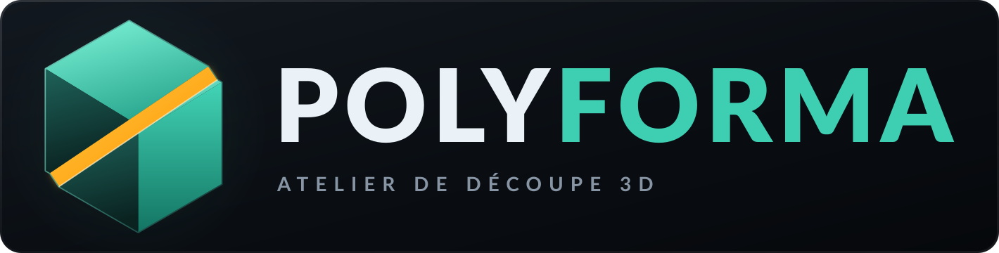

<p align="center">
  
</p>

# Polyforma

Atelier de bureau pour **découper et préparer de grands modèles 3D destinés à l'impression**.
Application locale en **Rust (Tauri v2)** avec une interface React/three.js, inspirée de
[LuBan](https://luban3d.com).

Le binaire `LuBan` présent à la racine est conservé tel quel comme référence : il ne fait pas
partie de l'application et n'est pas modifié.

---

## Fonctionnalités

- **Import** de modèles STL (binaire et ASCII), OBJ et 3MF, par dialogue ou glisser-déposer.
  Les packages 3MF multi-fichiers (extension production `p:path`, utilisée notamment par Bambu Lab)
  sont pris en charge : la racine est résolue via `_rels/.rels`, les parties `.model` externes sont
  lues récursivement, et les transformations parent/enfant ainsi que les unités de chaque partie
  sont appliquées.
- **Découpe par plan** sur X, Y ou Z, avec position réglable et aperçu du plan dans la vue 3D.
- **Découpe automatique** : le modèle est découpé par plans répartis uniformément pour que chaque
  pièce tienne dans le volume d'impression, en tenant compte de la marge.
- **Connecteurs** cylindriques (tenons d'un côté, logements de l'autre), sans opération booléenne
  lourde. Le rayon, la profondeur et la tolérance (jeu) sont réglables ; en mode automatique, seul
  le nombre et le placement sont calculés, la taille demandée est conservée.
- **Réparation** du maillage : soudure des sommets, suppression des triangles dégénérés, recalcul
  des normales.
- **Évidement** : vide l'intérieur d'un modèle plein en ne conservant qu'une coque d'épaisseur
  réglable. La surface intérieure est calculée par décalage des faces vers l'intérieur, puis
  retournée et fusionnée avec la surface extérieure. Le déplacement de chaque sommet est plafonné
  par l'épaisseur locale du matériau (mesurée par lancer de rayon), puis lissé : les détails fins
  gardent une paroi plus mince au lieu de faire échouer l'opération. Le volume avant/après est
  indiqué et un avertissement signale les zones où l'épaisseur demandée n'a pas pu être tenue.
- **Couleurs 3MF** : les couleurs par triangle (`basematerials` et `m:colorgroup`) sont lues à
  l'import, ainsi que les peintures multicolores Bambu Studio / Orca Slicer (`paint_color`,
  palette `filament_colour` et extruder par défaut des métadonnées). Elles sont propagées lors des
  découpes, réparations, transformations et évidements, affichées dans la vue 3D et réécrites à
  l'export 3MF. Les bouchons et connecteurs reprennent la couleur dominante de la pièce.
- **Transformations** : translation, rotation, mise à l'échelle, hauteur cible, ajustement au
  plateau, pose sur le plateau, centrage, miroir.
- **Organisation** : duplication, suppression, disposition automatique sur le plateau,
  sélection multiple.
- **Vue éclatée** : les pièces s'écartent radialement du centre de la scène, avec une animation
  douce, sans modifier la géométrie exportée. Le recadrage caméra tient compte de l'écartement.
- **Historique** annuler/rétablir (16 niveaux).
- **Export** :
  - STL binaire (un fichier par pièce, dans un dossier) ;
  - OBJ groupé (toutes les pièces dans un seul fichier) ;
  - 3MF groupé (toutes les pièces dans un seul fichier), avec conservation des couleurs.
  - Les exports OBJ et 3MF répartissent automatiquement les pièces sur le plateau.
- **Estimation du filament** : volume de matière, masse et longueur de filament nécessaires en
  fonction du matériau (PLA, PETG, ABS, ASA, TPU), du taux de remplissage et des parois pleines.
  La masse estimée est aussi rappelée dans l'en-tête.
- Aperçu 3D performant, couleurs par sommet incluses : la géométrie reste dans le backend Rust et
  transite par IPC binaire.
- Interface entièrement en français, thème sombre « atelier industriel ».

---

## Prérequis

- **Node.js 18+** et **npm**
- **Rust 1.77+** (avec `cargo`)
- Les dépendances système de Tauri v2.

Sur Debian/Ubuntu :

```bash
sudo apt update
sudo apt install -y build-essential curl wget file \
  libwebkit2gtk-4.1-dev libxdo-dev libssl-dev \
  libayatana-appindicator3-dev librsvg2-dev
```

Sur les autres distributions, consultez la
[documentation des prérequis Tauri](https://v2.tauri.app/start/prerequisites/).

---

## Installation

```bash
git clone git@github.com:Theora59-dev/SUPERTRUC2000.git Polyforma
cd Polyforma
npm install
```

## Développement

```bash
npm run tauri dev
```

Vite démarre sur le port **1420** (port strict) et la fenêtre Tauri s'ouvre automatiquement.

## Build de production

```bash
npm run tauri build
```

Les binaires et paquets sont générés dans `src-tauri/target/release/` (et
`src-tauri/target/release/bundle/` pour les installeurs).

Pour compiler uniquement l'exécutable, sans créer d'installeur :

```bash
npm run tauri build -- --no-bundle
```

---

## Utilisation

1. **Importer** un modèle avec le bouton d'import ou en le glissant dans la fenêtre.
2. **Découpe** (onglet par défaut) :
   - choisissez l'axe et la position du plan ;
   - activez éventuellement les connecteurs et réglez leur rayon, profondeur et tolérance ;
   - cliquez sur « Découper ». Les deux pièces apparaissent dans la liste.
3. **Auto** : ajustez le plateau (X, Y, Z, marge), puis lancez la découpe automatique sur toutes
   les pièces ou sur la sélection. L'application estime le nombre de pièces avant de couper. Les
   champs de taille et de tolérance des tenons restent disponibles en mode automatique.
4. **Édition** : sélectionnez une pièce dans la liste ou dans la vue 3D, puis appliquez une
   transformation, réparez-la, évidez-la, dupliquez-la ou supprimez-la.
   - **Évidement** : réglez l'épaisseur des parois (en mm) puis cliquez sur « Évider la pièce ».
     L'application réduit automatiquement l'épaisseur là où la géométrie ne la permet pas (détails
     fins, parois minces) et signale les zones concernées au lieu de refuser l'opération.
5. **Export** : choisissez le format, la portée (tout ou sélection) et le fichier/dossier de
   destination. L'onglet Export affiche aussi l'estimation de filament : choix du matériau, taux
   de remplissage, volume de matière, masse et longueur nécessaires.

La **vue éclatée** s'active avec le bouton « Éclater » de la surcouche 3D ou la touche `E` ;
la touche `!` (ou un second appui) rassemble les pièces. L'écartement est purement visuel :
les fichiers exportés conservent les positions réelles des pièces.

Le plateau par défaut est de **220 × 220 × 250 mm** avec une marge de **5 mm**. Ces valeurs
servent au calcul de la découpe automatique et à la disposition des exports groupés.

### Raccourcis clavier

| Raccourci | Action |
| --- | --- |
| `Ctrl+O` | Importer un modèle |
| `Ctrl+Z` | Annuler |
| `Ctrl+Shift+Z` ou `Ctrl+Y` | Rétablir |
| `Ctrl+D` | Dupliquer la pièce sélectionnée |
| `Suppr` | Supprimer la pièce sélectionnée |
| `F` | Recadrer la caméra sur la scène |
| `E` | Éclater / rassembler les pièces |
| `!` | Rassembler les pièces |
| `Échap` | Désélectionner |

---

## Architecture

```
Polyforma/
├── LuBan                  # binaire de référence d'origine (non utilisé)
├── assets/
│   ├── icon.svg           # icône de l'application (source des icônes Tauri)
│   ├── mark.svg           # symbole Polyforma seul
│   └── logo.svg           # bannière de marque (symbole + nom)
├── public/favicon.svg     # favicon de l'interface
├── index.html
├── src/                   # frontend React + TypeScript + three.js
│   ├── App.tsx            # interface, état, commandes, export
│   ├── Viewport.tsx       # scène 3D, caméra, sélection, aperçu
│   ├── api.ts             # contrat IPC et types partagés
│   ├── Icons.tsx          # icônes SVG
│   └── styles.css         # thème sombre
└── src-tauri/
    ├── src/
    │   ├── lib.rs         # enregistrement Tauri
    │   ├── main.rs
    │   ├── commands.rs    # commandes exposées au frontend
    │   ├── workspace.rs   # état, découpe, transformations, export, tests
    │   ├── cut.rs         # découpe plane, bouchons, connecteurs, couleurs
    │   ├── mesh.rs        # maillage, bornes, statistiques, évidement, couleurs
    │   ├── io_stl.rs      # lecture/écriture STL
    │   ├── io_obj.rs      # lecture/écriture OBJ
    │   └── io_3mf.rs      # lecture/écriture 3MF
    └── tauri.conf.json
```

### Principes techniques

- **Toute la géométrie est traitée en Rust.** Le frontend ne fait qu'afficher le résultat.
- **Aperçu binaire** : `preview_mesh` renvoie un `ArrayBuffer` composé de
  `u32 vertex_count`, `u32 index_count`, puis des positions `f32 × 3`, des indices `u32` et,
  si le modèle est coloré, une couleur RGB par sommet (3 octets, moyenne des couleurs des
  triangles adjacents). Cela évite le coût du JSON pour les gros maillages.
- **Cache d'aperçu** : chaque pièce possède une `revision` ; le frontend ne recharge la géométrie
  que lorsque celle-ci change.
- **Découpe sans CSG** : les bouchons de coupe sont triangulés avec `earcutr`. Le contour de
  section est d'abord équilibré (fusion des sommets confondus ou déséquilibrés), puis les
  fissures résiduelles laissées sur le plan par la triangulation sont comblées à la soudure
  (`seal_open_boundaries`), ce qui garantit des demi-pièces étanches même sur un modèle
  non-manifold. Les connecteurs sont des cylindres : des tenons sur la pièce négative et des
  logements percés depuis le plan sur la pièce positive, ce qui reste rapide et robuste. La
  tolérance est ajoutée au rayon des logements.
- **Couleurs par triangle** : `Mesh.tri_colors` stocke une couleur RGB par triangle (vide si le
  modèle n'en a pas). Toutes les opérations qui reconstruisent le maillage propagent ces couleurs ;
  l'export 3MF écrit un groupe `basematerials` par pièce avec `pid`/`p1` sur chaque triangle.
- **Évidement** : chaque sommet est décalé vers l'intérieur en résolvant au mieux les plans
  tangents de ses faces adjacentes (moindres carrés), avec repli sur la normale moyenne. Un arbre
  de volumes englobants (BVH) mesure l'épaisseur locale par lancer de rayon ; le déplacement est
  plafonné à une fraction de cette épaisseur et lissé sur le voisinage. La coque intérieure est
  inversée puis fusionnée à l'extérieur pour former une paroi étanche.
- **Estimation filament** : réalisée côté frontend à partir du volume et de la surface de chaque
  pièce, avec des parois pleines de 1,2 mm, le remplissage choisi, la densité du matériau et un
  filament de 1,75 mm.

---

## Tests

Tests unitaires du backend (soudure, miroir, aller-retour STL, découpe étanche, découpe
automatique, évidement, couleurs par triangle et exports STL/OBJ/3MF) :

```bash
cd src-tauri
cargo test --lib
```

Vérification du frontend (TypeScript + build Vite) :

```bash
npm run build
```

---

## Limites connues

- La découpe se fait uniquement par **plans droits** alignés sur X, Y ou Z (pas de découpe
  courbe ou guidée par une surface).
- La découpe automatique est limitée à **256 pièces** par opération.
- Les connecteurs sont des **cylindres simples** ; il n'y a pas encore de tenons coniques, de
  queues d'aronde ni de vissage.
- Les maillages très lourds (plus de **1,5 million de triangles**) sont acceptés mais peuvent
  ralentir l'aperçu.
- Il n'existe pas encore de sauvegarde de projet : l'atelier est perdu à la fermeture.
- L'historique est limité à **16 niveaux**.
- L'évidement s'adapte localement à l'épaisseur disponible mais ne gère pas encore les ouvertures
  de vidange ; les maillages ouverts restent déconseillés.
- L'estimation filament est indicative : elle ne simule pas les supports, les purges de changement
  de couleur ni les réglages exacts du trancheur.
